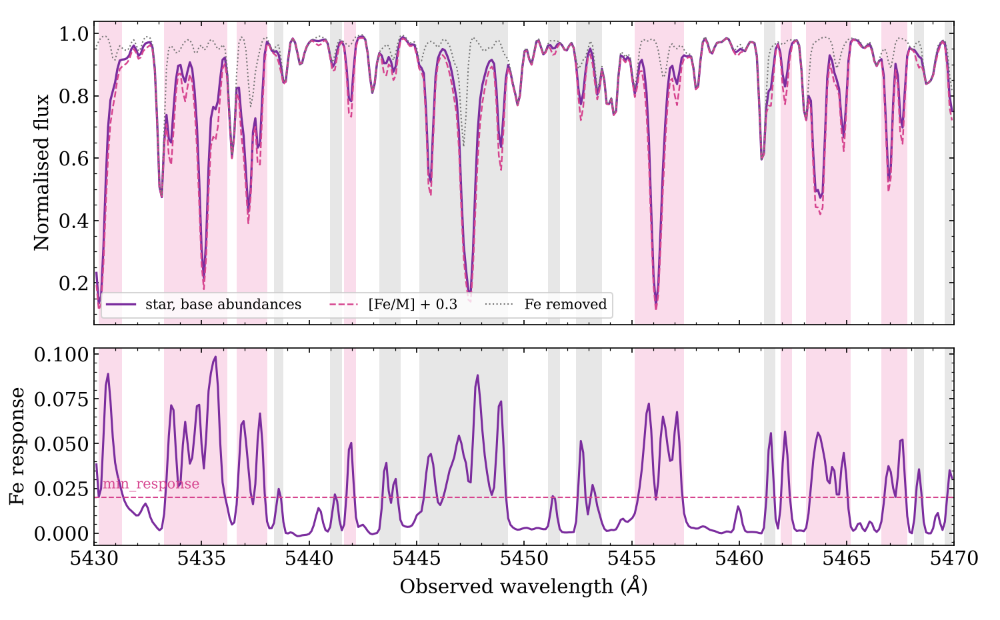
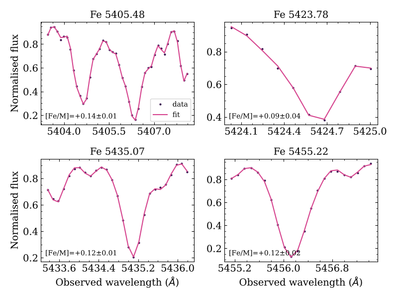

# 8. Line-by-line abundances

`linefit.py` measures abundances window by window for a star whose stellar parameters are already known, usually from FERRE. For each window it fits:

* **[X/M]**: the abundance;
* **ΔRV**: a small velocity offset;
* **vmac**: macroturbulent broadening;
* **a local continuum**: a polynomial per window.

Each abundance comes with a statistical error and a systematic error propagated from the stellar-parameter uncertainties.

## 8.1 Setting up a `LineFitter`

```python
import turbogrid, linefit, nlte

lf = linefit.LineFitter(
    linelists=['atomic.list', 'molecular.list', 'Hlinedata'],
    inst=dict(R=22500.),                                   # any instrument from chapter 4
    # CNO-LTE: the atmosphere nodes and how to find a node's file
    nodes=dict(teff=(15, 3000., 250.), logg=(12, -0.5, 0.5), mh=(14, -2.5, 0.25),
               am=(7, -1.0, 0.25), cm=(11, -1.5, 0.25)),
    atmod_lookup=turbogrid.make_atmod_lookup('/data/marcs_apogee', flat=True),
    # NLTE for these elements wherever data exist (optional)
    nlte=nlte.NLTEConfig('/data/marcs_standard', '/data/nlte_data'),
    nlte_elems=['Mg', 'Al', 'Ca'],
    n_jobs=16)                                             # parallel Turbospectrum runs
```

Node axes can be `(n, start, step)` triplets, as in turbogrid, or explicit arrays.

| option | default | meaning |
|---|---|---|
| `offsets` | −0.6 … +0.6 in 0.2 dex steps | abundance ladder around the starting [X/M]; extended automatically if a fit reaches its end (`max_extend=2` times) |
| `drv_max` | 5 km/s | bound on the per-line velocity offset |
| `vmac`, `vsini` | 3.0, 0.0 km/s | starting / fixed stellar broadening (see 8.5) |
| `cont_deg` | 1 | continuum polynomial per window (0 = scale only, `None` = none) |
| `dw` | 0.02 Å | synthesis step for the full-range runs in `automask` |
| `workdir` | temporary | where the Turbospectrum runs happen |

`lf.mode('Mg')` tells you which mode an element will use.

## 8.2 The two modes

**CNO-LTE** is used for every element not handled in NLTE.

* turbofit finds the cell of the atmosphere grid around the star: 2⁵ = 32 nodes in (Teff, log g, [M/H], [α/M], [C/M]).
* It synthesises each element's abundance ladder at every node, then interpolates the *spectra* multilinearly to the star's parameters.
* Atmospheres are never interpolated.
* Every node is synthesised with the **star's** abundances, so only the atmospheric structure is interpolated, not the line strengths of other species.
* A star exactly on a node still gets a full cell. The neighbour node carries zero weight but provides the derivatives used for the systematics.
* A missing node atmosphere raises an error that names the missing corners. Fill the grid with `atmos.fill_holes()` first.

**NLTE** is used for elements listed in `nlte_elems` that have data.

* Turbospectrum's interpolator gives the atmosphere and the departure coefficients at the exact parameters ([chapter 3](03-nlte.md)).
* There is one synthesis per abundance step and no node interpolation.

In both modes only the line windows are synthesised (Turbospectrum segments). Every fit iteration afterwards is pure interpolation plus broadening, with no Turbospectrum calls.

## 8.3 Line masks

### Your own

```python
mask = linefit.read_mask('mg_lines.txt')                    # turbofit format
mask = linefit.read_mask('fe-lmask.txt', element='Fe')     # TSFitPy format (; comments)
```

turbofit format, one window per line, **rest-frame** wavelengths in the same convention as your line lists:

```
# element  center  wmin  wmax  response  blend
Mg   15740.716  15739.900  15741.500   0.0810  0.050
C    15578.400  15577.950  15578.900   0.0420  0.180
```

### Automatic: built for each star and instrument

```python
mask = lf.automask(['C', 'N', 'O', 'Mg', 'Al', 'Fe'], star, wave,
                   dx=0.3, min_response=0.02, max_blend=0.3, cut=0.25,
                   exclude=[(15890., 15960.)])     # observed-frame ranges to avoid
linefit.write_mask(mask, 'star1_mask.txt')          # inspect / edit / reuse
```



*How `automask` chooses windows (Fe, 4500 K giant, R = 20 000).*

* **Top:** the star (purple), with [Fe/M] + 0.3 (pink dashed) and with Fe removed (grey dotted).
* **Bottom:** the Fe response.
* **Shading:** pink windows are kept; grey windows respond to Fe but are dominated by other species.

What it does:

1. Synthesises the star over the observed range for three cases: the base abundances, [X/M] + `dx` for each element, and each element removed. It uses the nearest atmosphere node, or NLTE if no nodes are configured.
2. Broadens everything with *your* instrument and resamples onto *your* pixels at the star's RV.
3. Computes the response, r = F_base − F_+dx, and finds peaks above `min_response` at least one FWHM apart.
4. Grows each window until r falls below `cut` × the peak.
5. Measures the **blend fraction**: the response-weighted share of the line depth that comes from *other* species. This uses the spectrum with X removed. Windows with blend > `max_blend` are dropped.
6. Merges overlapping windows and records `response` and `blend` for each.

This works the same way for molecular features (C from CO/CN/CH, N from CN, O from OH) as for atomic lines.

> [!TIP]
> `min_response` is a flux change for +`dx` dex. A sensible value is a few times your noise per pixel, divided by √(pixels per line). Low-S/N spectra want a higher threshold. Lines that end up too weak are flagged `weak` anyway (8.8).

## 8.4 Fitting

```python
star = dict(teff=4520., logg=1.9, mh=-0.42, am=0.18, cm=-0.20, nm=0.30,
            vmicro=1.6, rv=-121.4)
star_err = dict(teff=50., logg=0.10, mh=0.05, am=0.03, cm=0.05)

res = lf.fit(wave, flux, err, star, mask=mask, star_err=star_err,
             vmac='global', iterate=1, profile=True, mc=0)
```

If `mask` is omitted, `elements=[...]` must be given and `automask` is run once.

**The model for each window** is built in this order:

1. The interpolated ladder is turned into a continuous function of [X/M] with a cubic spline.
2. Stellar broadening is applied.
3. The LSF, the Doppler shift (star RV + ΔRV) and resampling onto the observed pixels are applied together.
4. The model is multiplied by a continuum polynomial, which is solved linearly at every step.

The fit uses `scipy.optimize.least_squares`, with [X/M] bounded by the ladder. When a fit reaches the ladder's end, the ladder is extended and the window refitted.

**Measurement errors:** see 8.6 below.

### Blends between fitted elements: `iterate`

Pass 1 fits every element with the starting abundances. Each extra pass (`iterate=1` gives two passes in total) feeds the measured means back into the synthesis as `star['elems']`, so a Ti line blending an Fe window is modelled at the measured Ti abundance. Each pass re-synthesises the ladders.

Known abundances of other species can also be given directly:

```python
star['elems'] = [['Ce', 0.2], ['Nd', 0.3]]
```

## 8.5 Macroturbulence: `vmac=`

| value | behaviour |
|---|---|
| `'global'` (default) | a first pass fits vmac per line; it is then fixed to the median of the good lines, weighted by `snr_resp` |
| `'line'` | free for every line (beware: degenerate with abundance for weak lines in narrow windows) |
| a number | fixed |

The value used is stored in `res.vmac`.

## 8.6 Measurement errors on the abundances

There are three per-line estimates of the measurement (noise) error on [X/M], and a combined error for each element.

| column | how it is computed | cost |
|---|---|---|
| `err_stat` | curvature of χ² at the best fit (from the Jacobian), scaled by √χ²_red when χ²_red > 1 | free |
| `err_lo`, `err_hi` | **χ² profile**: [X/M] is stepped across the best fit, with the RV offset (and vmac, if free) re-optimised at each step. The errors are where χ² rises by 1 (in units of χ²_red when that exceeds 1). They can be asymmetric, which matters for weak lines and lines on the saturated part of the curve of growth. `inf` means χ² never rose by 1 within the abundance ladder, so the line does not constrain the abundance on that side. | ~17 small refits per line; on by default (`profile=True`) |
| `err_mc` | **Monte Carlo**: the line is refitted `mc` times with Gaussian noise drawn from your `err` added to the data. This is the standard deviation of those fits. | `mc` refits per line; off by default (`mc=0`; `mc=100` is plenty) |

None of these need extra Turbospectrum runs; they only refit the interpolated model. They are computed on the final pass only. Pass `seed=` for reproducible Monte Carlo errors.

These errors describe the noise in your spectrum, so they are only as good as your `err` array. If the per-pixel errors are underestimated, χ²_red > 1 and `err_stat`/`err_lo`/`err_hi` are inflated accordingly. `err_mc` is not, so compare it with them as a check.

**For each element** (`res.summary`):

| key | meaning |
|---|---|
| `err_mean` | error of the weighted mean from the per-line `err_stat` |
| `std`, `err_scatter` | line-to-line standard deviation, and `std/√n` |
| `err_meas` | measurement error of the mean: the larger of `err_mean` and `err_scatter` |
| `err_sys` | stellar-parameter systematic (8.7), correlated between lines |
| `err_total` | √(`err_meas`² + `err_sys`²) |

Using the larger of the propagated error and the observed scatter means the quoted error of the mean also covers line-to-line problems the noise model does not know about (log gf errors, unmodelled blends, continuum placement).

**Calibration test.** One simulated spectrum (4500 K giant, R = 20 000, S/N = 100, [Fe/M] = +0.15) was refitted with 12 independent noise realisations. For six Fe windows, the spread of the fitted [Fe/M] values matched the error estimates:

| window (Å) | true scatter | `err_stat` | `err_lo` | `err_hi` | `err_mc` (40 draws) |
|---|---|---|---|---|---|
| 5405.48 | 0.016 | 0.015 | 0.015 | 0.015 | 0.013 |
| 5423.78 | 0.043 | 0.044 | 0.045 | 0.044 | 0.043 |
| 5435.07 | 0.019 | 0.020 | 0.020 | 0.020 | 0.019 |
| 5417.06 | 0.131 | 0.141 | 0.135 | 0.144 | 0.147 |

With 12 realisations the "true scatter" is itself uncertain by about 20 %.

## 8.7 Systematic errors from the stellar parameters

In **CNO-LTE** mode these cost no extra synthesis. The node spectra are already computed, so for each parameter p in `star_err`:

1. the node weights are recomputed at p ± σ_p, staying within the cell;
2. the abundance is refitted with everything else held fixed;
3. the derivative d[X/H]/dp is stored.

The systematic error on [X/M] combines the terms in quadrature, using d[X/M]/d[M/H] = d[X/H]/d[M/H] − 1. Element means treat these errors as **correlated** between lines: the mean derivative is propagated, rather than averaging per-line errors.

These derivatives cover the effect of the *atmospheric structure*. Blending species that scale with [M/H] are held at the star's values.

Optional extras, which need extra syntheses:

* `sys_vmicro=True`: adds vmicro, from ladders at vmicro ± σ for the dominant node only (two extra ladders per element).
* `sys_nlte=True`: in NLTE mode, ladders at Teff, log g and [M/H] ± σ (and vmicro). That is six to eight extra ladders per element.

## 8.8 Results

```python
res.summary['Fe']
# {'n': 7, 'xm': 0.129, 'xh': -0.291, 'err_mean': 0.007, 'std': 0.043,
#  'err_scatter': 0.016, 'err_meas': 0.016, 'err_sys': 0.112, 'err_total': 0.113,
#  'mode': 'CNO-LTE'}
t = res.table()          # astropy Table, one row per window
res.write('star1_lines.csv')
```

| column | meaning |
|---|---|
| `element, center, wmin, wmax` | the window (rest frame) |
| `mode` | `CNO-LTE` or `NLTE` |
| `xm`, `xh` | [X/M] and [X/H] (= [X/M] + the star's [M/H]); see below for [X/Fe] |
| `err_stat`, `err_lo`, `err_hi`, `err_mc` | measurement errors on [X/M] (8.6) |
| `err_sys` | parameter-propagated systematic error on [X/M] (8.7) |
| `dxh_d<p>` | d[X/H]/dp for each parameter in `star_err` |
| `drv`, `vmac` | per-line velocity offset and the vmac used |
| `chi2r`, `npix` | reduced χ² and number of pixels |
| `snr_resp` | how many σ a 0.1 dex change makes in this window |
| `response`, `blend` | from the mask |
| `flags` | `edge` (at the ladder end after extension), `weak` (`snr_resp` < 3), `poorfit` (χ²_red > 5), `nodata` (< `min_pix` usable pixels) |
| `ok` | not `edge` and not `weak`; only `ok` lines enter `summary` |

Summary means are weighted by 1/err_stat², with a floor of 0.01 dex.

**[X/M] versus [X/Fe].** `xm` is relative to the star's overall [M/H]. That equals [X/Fe] only while Fe sits at [Fe/M] = 0. If Fe is among the fitted elements, quote:

```python
x_fe = res.summary['Mg']['xh'] - res.summary['Fe']['xh']      # [Mg/Fe]
```

For its error, combine the two statistical errors in quadrature (`err_mean`, or `std`/√n). The [M/H] part of the systematic error largely cancels in the difference, because both elements respond to [M/H] in the same way. The derivatives in `dxh_dmh` show by how much.

## 8.9 Plots

```python
linefit.plot_lines(res, 'star1_lines.pdf', ncols=4, element='Fe',
                   colors=('#3A1450', '#D6458F'))      # data, model; default black/red
```



*Fits to four automatically selected Fe windows (simulated R = 20 000, S/N = 150 spectrum with [Fe/M] = +0.15).*

## 8.10 How well does it work?

Tests on simulated spectra (4500 K giant, R = 20 000, VALD atomic lines, 5400–5500 Å):

* **Noise-free, same atmosphere:** [Fe/M] = +0.15 was recovered to **±0.003 dex** line by line.
* **S/N 150, blends from Ti, Ni and Ca at non-solar abundances, vmac fitted:**
    * [Fe/M] = 0.136 ± 0.014 (truth 0.15);
    * [Ti/M] = −0.213 ± 0.021 (truth −0.20);
    * global vmac = 3.7 km/s (truth 4.0).
* **The same fit with a per-pixel LSF array instead of R:** [Fe/M] = 0.139 and [Ti/M] = −0.191.
