# turbofit user guide

turbofit is a Python toolkit around **Turbospectrum v20**. It covers:

* synthesising spectra, one at a time or many abundance patterns per star;
* building FERRE grids;
* measuring radial velocities;
* fitting stellar parameters with FERRE;
* fitting abundances line by line.

For each element you choose how it is synthesised:

* **CNO-LTE**: APOGEE MARCS atmospheres with [C/M] and [α/M] nodes, in LTE.
* **NLTE**: standard MARCS atmospheres plus departure coefficients, for elements that have NLTE data.

## Contents

| | chapter | what it covers |
|---|---|---|
| 1 | [Installation](01-installation.md) | Turbospectrum, csh, atmospheres, NLTE data, FERRE, environment variables |
| 2 | [Synthesising spectra](02-synthesis.md) | `synthesize()`, abundances, segments, abundance sets and ladders |
| 3 | [NLTE](03-nlte.md) | `NLTEConfig`, what happens under the hood, choosing elements |
| 4 | [Broadening, LSFs and resampling](04-broadening.md) | vmac/vsini, R, R(λ), LSF arrays, Doppler shift, output grids |
| 5 | [Building grids for FERRE](05-grids.md) | turbogrid workflow, on-the-fly LSF, NLTE grids, log-λ grids |
| 6 | [Radial velocities](06-radial-velocity.md) | CCF and χ² refinement |
| 7 | [Stellar parameters with FERRE](07-ferre.md) | the FERRE driver, inputs and outputs |
| 8 | [Line-by-line abundances](08-line-by-line.md) | modes, automatic masks, fitting, systematics, outputs, plots |
| 9 | [The full pipeline](09-pipeline.md) | RV → FERRE → masks → abundances for one star |
| 10 | [Troubleshooting and known quirks](10-troubleshooting.md) | errors you may see and what to do |
| 11 | [API reference](11-api-reference.md) | every public function and its arguments |

## Conventions used throughout

* **Abundances.** `mh` is [M/H], `am` is [α/M], `cm` is [C/M] and `nm` is [N/M].
    * Individual elements are given as `[X/M]` with `elems=[['Mg', 0.3], ['Al', -0.1]]`.
    * The α elements are O, Ne, Mg, Si, S, Ar, Ca and Ti.
    * Solar abundances are Grevesse et al. (2007), which is also Turbospectrum's default.
* **Wavelengths** are in Å. They follow your line lists, so air or vacuum depending on what you use.
* **Spectra passed to the fitting routines** must be continuum-normalised, with 1σ errors per pixel.
    * Bad pixels can be marked with `err = inf` or `nan`.
* **Radial velocities** are in km/s, with positive meaning receding. Observed spectra stay in the observed frame; turbofit applies the shift.
* **Imports are flat.** Put the turbofit folder on your `PYTHONPATH` (or `sys.path`) and use `import synthesis, linefit, ...`.
